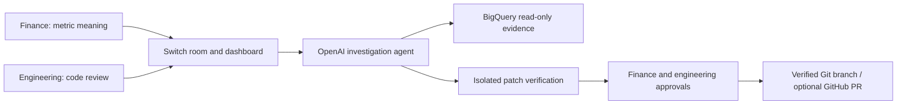

# Incident Room

A collaborative data incident investigator for **BigQuery, OpenAI and Switch**. Finance confirms what a metric means; an agent inspects actual warehouse evidence and SQL; two independent reviewers approve the exact tested patch; engineering publishes that patch as a Git branch.

Investigations use real warehouse queries, source SQL and model function calls. Missing configuration produces an explicit blocker. The hosted installation also has a separately labelled presentation dataset with a documented SQL fault; it uses the same investigation and review workflow.

Hosted dashboard: https://incident-room-281482385461.us-central1.run.app. See [hosted access and operations](docs/HOSTED.md) and the [presentation guide](docs/PRESENTATION.md). Google sign-in is restricted to invited reviewers.

## Repository and presentation data

This repository contains the API (`backend/`), dashboard (`frontend/`), deployment scripts (`deploy/`), tests (`tests/`) and the presentation SQL (`models/`, `assertions/`). The SQL Git history is preserved so future verified repair branches can be compared against this same repository.

**The daily SQL on `main` intentionally omits cancellations.** It belongs to the disclosed, isolated `incident_room_presentation` dataset. It is the starting fault for a real investigation, not a recommended production transform. A minimal correction passes six independent checks; the model must still gather evidence and the actual reviewers must approve the exact proposal. The original retail warehouse is unchanged.



The hosted installation currently creates repair branches on its server. Authenticated automatic push/PR publication is a separate repository-access configuration; publishing this source does not grant the running agent GitHub credentials.

## Run it

Start with [the setup guide](docs/SETUP.md). It covers Google credentials and permissions, your real SQL repository and assertions, local OpenAI configuration, and Switch installation and agent registration.

```powershell
cd D:\SwitchHackathon\src\incident-room
uv sync --frozen
Copy-Item config\bigquery.project.example.json config\project.local.json
# Fill in project.local.json with your actual tables, SQL files, metrics and contracts.
uv run python -m incident_room.configure
uv run python -m incident_room.preflight
powershell -ExecutionPolicy Bypass -File scripts\start-local.ps1
```

Dashboard: http://127.0.0.1:3000. Authenticated API: http://127.0.0.1:8400/docs. Start the Switch adapter separately after completing its setup:

```powershell
uv run python -m incident_room.switch_adapter
```

## What is implemented

- Google sign-in with invited finance, engineering and viewer memberships; hashed, revocable HttpOnly sessions and CSRF protection. Stable Google subject IDs enforce independent reviewers. Operator bearer tokens are a local fallback and are disabled in production. Finance owns the business definition. New context invalidates previous evidence, proposals and approvals.
- OpenAI Responses API with actual function calls for scoped SQL, source reads, metadata, requests for clarification, patch proposals, and evidence-backed no-repair conclusions. Tool results, SQL and BigQuery job IDs persist as evidence.
- SQL parsing plus BigQuery dry runs, explicit table allowlists, query deadlines, row limits and per-job byte ceilings. Source reads have no destination table. Qualified UDFs and external operations are rejected.
- A unique BigQuery validation dataset for each patch attempt. Allowed tables are cloned; all configured SELECT transforms rebuild in dependency order against those clones; zero-violation assertions and metric bounds determine pass/fail. Scratch tables expire after one hour; the dataset is removed on completion or failure.
- A proposal digest binds SQL content, source/configuration fingerprint, evidence, revision, diff and verification result. Both finance and engineering must approve it. Source changes block approval or publication.
- Publication repeats isolated verification, creates a separate Git worktree, commits the exact tested SQL bytes to `incident-room/<incident-id>`, and preserves the main checkout. Optional GitHub PR creation uses existing Git/gh credentials. Production deployment is explicitly pending.
- Persistent incidents and audit entries with optimistic concurrency. Restarted jobs become interrupted states rather than replaying mutations. SQLite works locally; PostgreSQL is supported through `DATABASE_URL`.
- Switch WebSocket delivery with immediate pongs, persisted connection ID/generation/cursor, sender-to-reviewer binding, duplicate event records and explicit stops on uncertain delivery or history gaps. The dashboard and Switch commands use the same API state machine.

## Supported scope and operational limits

Use **one API process/worker and one adapter** per installation. All signed-in reviewers share one configured project. Local Windows launch scripts are provided. [Deployment instructions](docs/DEPLOYMENT.md) cover the complete container stack, persistent PostgreSQL, Google sign-in and HTTPS.

The warehouse adapter is BigQuery. Snowflake is not implemented. Inputs must be stable materialized TABLE assets in compatible BigQuery locations and organization; streaming buffers, views, external tables and time-travel modifiers are rejected. SQL transforms are ordered, standalone GoogleSQL SELECT queries with explicit outputs, not Jinja/dbt programs, scripts or DDL. Configure the complete dependency set. Validation success is only as strong as the business assertions and metric bounds you supply.

The stale-source fingerprint uses BigQuery table metadata (etag, modification time, schema, row/byte counts), Git HEAD, SQL/configuration bytes and configured DataHub metadata. It does not hash every warehouse row or provide a transactional lock over live upstream pipelines. Use stable snapshots or pause upstream writes while reviewing repairs. A verified Git branch is the delivered repair artifact; no production SQL deployment is performed.

Switch currently uses explicit room commands and `!status` to retrieve asynchronous investigation results. It does not ingest attachments or automatically infer authority from natural language. If message posting succeeds but acknowledgement storage fails, a repeated outbound reply is possible; domain events marked as processing require operator reconciliation rather than automatic replay.

## Verification

```powershell
uv run pytest -q
cd frontend
npm ci
npm run build
```

Tests cover authentication, role separation, context and stale-source invalidation, query boundaries, scratch cleanup, exact Git publication, database transfers, and Switch heartbeat/deduplication behavior. See [validation evidence](docs/VALIDATION.md) for completed real BigQuery, OpenAI and Switch checks; provider doubles remain confined to automated tests.

Architecture inspiration and upstream license details: [ATTRIBUTION.md](docs/ATTRIBUTION.md). Reference source is kept separately at `D:\SwitchHackathon\src\blackbox-reference`.
